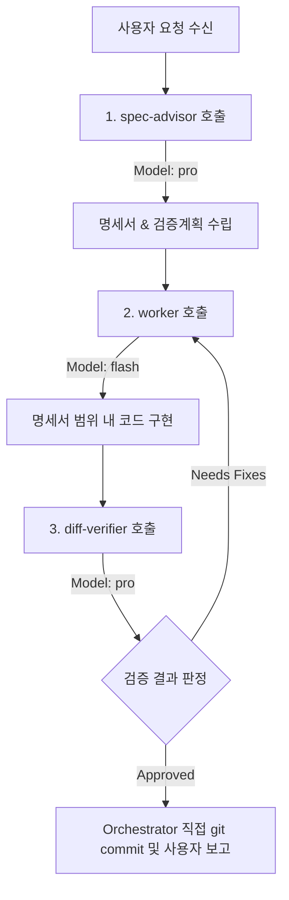

# Antigravity Orchestrator 하네스 운영 규칙 (3-Role Dispatch)

본 프로젝트는 **1개의 Orchestrator (메인 세션)**가 3개의 전문 롤(`spec-advisor`, `worker`, `diff-verifier`) 서브에이전트 분업 체계를 관리하고 운영하는 **Spec-Driven Development (SDD)** 방식으로 구동됩니다.

---

## 🤖 모델 티어 및 롤(Role) 정의

Orchestrator는 작업 진행 시 `invoke_subagent` 도구를 사용하며, 아래 표와 같이 적절한 모델 티어(`Model` 파라미터)를 지정하여 호출합니다.

| 롤 (Role) | 담당 분야 | 권장 모델 티어 (`Model`) | 주요 역할 및 제한 사항 |
| :--- | :--- | :--- | :--- |
| **Orchestrator** | 메인 통제 & 파이프라인 관리 | `inherit` / `pro` (기본 세션) | 전 과정 워크플로우 통제, 서브에이전트 디스패치, 최종 `git commit` 및 사용자 보고 |
| **spec-advisor** | 명세서 & 설계 수립 | `pro` (고성능 추론) | 코드 수정 금지. 요구사항 분석, 영향 범위, 검증 체크리스트가 포함된 명세서 산출 |
| **worker** | 코드 구현 & 단위 테스트 | `flash` (또는 `inherit`) | 명세서에 지정된 범위 내에서만 수정. git commit 금지, 범위 외 임의 변경 금지 |
| **diff-verifier** | 코드 리뷰 & 교차 검증 | `pro` (또는 `flash`) | `git diff` 및 테스트 결과 기반 Pass/Fail 판정. 직접 코드 수정 금지 |

---

## 🔄 3-Role 분업 운영 워크플로우 (Orchestrator 가이드)

Orchestrator(메인 세션)는 사용자의 요구사항을 수신하면 직접 코드를 수정하지 않고 아래 순서대로 3-Role 서브에이전트를 디스패치합니다:

### 1단계: 설계 (spec-advisor 디스패치)
- Orchestrator는 `invoke_subagent`를 사용하여 `spec-advisor` (Model: `pro`)를 실행합니다.
- `spec-advisor`는 코드를 직접 건드리지 않고, 수정 대상 파일/영향 범위/검증 체크리스트가 포함된 **기술 명세서**를 산출합니다.

### 2단계: 구현 (worker 디스패치)
- Orchestrator는 산출된 명세서를 `worker` (Model: `flash`)에게 전달하여 구현을 명령합니다.
- `worker`는 지정된 파일 범위 내에서만 구현 및 테스트를 수행하고 변경 요약을 반환합니다.

### 3단계: 검증 (diff-verifier 디스패치)
- Orchestrator는 `diff-verifier` (Model: `pro`)를 실행하여 `git diff` 및 명세서 체크리스트 교차 검증을 지시합니다.
- **Needs Fixes** 일 경우: 피드백 항목을 정리하여 `worker`에게 재작업을 전달합니다.
- **Approved** 일 경우: 통과 리포트를 Orchestrator에게 제출합니다.

### 4단계: 커밋 및 보고 (Orchestrator 실행)
- `diff-verifier`가 Approved 판정을 내리면, **Orchestrator 자신이 기계적 git commit을 직접 실행**합니다 (커밋 전용 서브에이전트를 따로 두지 않아 오버헤드 방지).
- 빌드/테스트 결과를 최종 확인한 후 사용자에게 완료를 보고합니다.

---

## ⚠️ 필수 준수 및 금지 사항

1. **직접 구현 금지 (Orchestrator)**: 메인 세션은 오케스트레이션과 최종 커밋만 담당하며 코드를 직접 편집하지 않습니다.
2. **명세서 이탈 금지 (worker)**: `worker`는 `spec-advisor`가 정한 영향 범위 밖의 파일이나 코드를 임의로 리팩토링하거나 변경하지 않습니다.
3. **직접 수정 금지 (diff-verifier)**: 검증자는 버그를 발견하더라도 직접 고치지 않고 지적 리포트만 작성하여 반환합니다.
4. **Subagent Model 파라미터 명시**: `invoke_subagent` 호출 시 `Model` 파라미터(`pro`, `flash` 등)를 반드시 명시해야 롤별 성능/비용 최적화가 유지됩니다.
5. **검증 없는 커밋 금지**: 단위 테스트 및 빌드 실패 상태에서는 절대로 git commit하지 않습니다.
